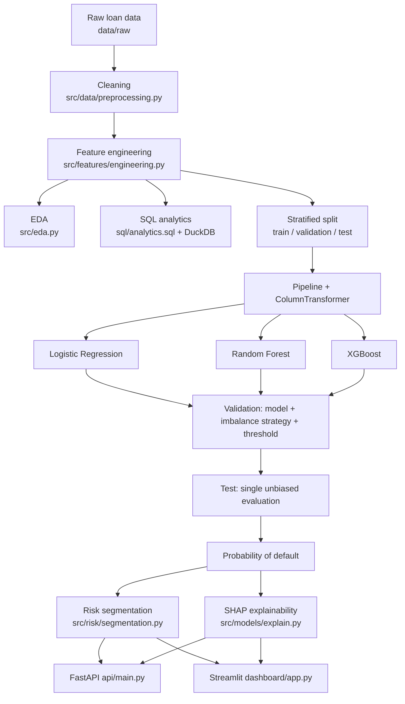

# Credit Risk & Loan Default ML Prediction

End-to-end credit-risk system: it cleans a public loan book, analyses it with SQL,
trains and compares three classical models, produces a **probability of default (PD)**
per customer, segments the portfolio into risk bands, explains every score with SHAP,
and serves the result through a FastAPI endpoint and a Streamlit dashboard.

Every number in this README was produced by `run_pipeline.py` on this repository.
Nothing is estimated, rounded up, or copied from a blog post.

---

## Overview

| | |
|---|---|
| **Task** | Binary classification: will this borrower default? |
| **Output** | Calibrated PD, risk band (Low / Medium / High), binary decision |
| **Data** | 32,580 loan applications, 12 columns, 21.87% default rate |
| **Selected model** | XGBoost (chosen on validation PR-AUC) |
| **Test ROC-AUC / PR-AUC** | **0.9444 / 0.9015** |
| **Serving** | FastAPI (`/predict`) + Streamlit dashboard (6 sections) |

---

## Business Problem

A lender approving consumer loans faces an asymmetric cost: a rejected good customer
loses a margin, an approved defaulter loses the principal. Accuracy is the wrong
target — with a 21.87% default rate, approving everyone already scores 78% accuracy
and destroys the book. What the business actually needs is:

1. a **ranked probability** it can price and set cut-offs against,
2. **segments** that map onto operational actions (auto-approve / review / decline),
3. an **explanation** for every decline, because a credit officer (and, in most
   jurisdictions, a regulator) will ask for one.

This project delivers all three.

---

## Objectives

- Predict the probability of default from application-time attributes only.
- Compare a transparent benchmark (logistic regression) against two ensembles.
- Handle class imbalance with evidence rather than habit.
- Keep predicted probabilities trustworthy, since the risk bands are defined on them.
- Ship the model behind an API and a dashboard, with SHAP explanations attached.

---

## Dataset

Public credit-risk loan dataset — one row per application, no customer identifier,
no time dimension.

| Property | Value |
|---|---|
| Rows / columns | 32,580 × 12 |
| Target | `loan_status` (1 = default, 0 = repaid) |
| Class balance | 21.82% default in raw data, 21.87% after cleaning |
| Numeric features | age, income, employment length, loan amount, interest rate, loan-to-income, credit-history length |
| Categorical features | home ownership, loan intent, loan grade, prior default on bureau file |

**Download:** place `credit_risk_dataset.csv` in `data/raw/`. The loader detects the
target from a candidate list (`loan_status`, `loan_default`, `default`, `default_flag`,
`is_default`), so a differently-named target still works.

### What inspection actually found

| Issue | Finding |
|---|---|
| Exact duplicates | 165 rows |
| Missing values | `loan_int_rate` 3,116 (9.56%), `person_emp_length` 895 (2.75%) |
| Impossible values | 4 ages up to 144, 2 employment lengths up to 123 |
| Identifier columns | none present |
| Leakage columns | none post-origination; `loan_grade` / `loan_int_rate` embed the lender's own risk view (kept, and flagged under Limitations) |
| Outliers | present in income and loan amount — **kept**, they are genuine |

---

## Project Architecture



```
credit-risk-loan-default-ml/
├── data/{raw,processed}/        # raw input, regenerated processed frames
├── notebooks/                   # 01 understanding → 06 explainability
├── src/
│   ├── config.py                # every path, threshold and seed
│   ├── eda.py
│   ├── data/preprocessing.py    # load, profile, clean
│   ├── features/engineering.py  # row-wise credit-risk features
│   ├── models/{train,predict,explain}.py
│   ├── evaluation/metrics.py    # metrics, threshold tuning, plots
│   ├── risk/segmentation.py     # configurable risk bands
│   └── analytics/runner.py      # DuckDB runner for sql/analytics.sql
├── sql/analytics.sql            # 12 named business queries
├── api/main.py                  # FastAPI service
├── dashboard/app.py             # Streamlit dashboard
├── models/                      # credit_risk_model.pkl, feature_config.json
├── reports/                     # metrics.json, comparisons, figures
├── tests/test_pipeline.py       # 16 pytest tests
└── run_pipeline.py              # reproduces everything
```

---

## Data Cleaning

| Decision | Reasoning |
|---|---|
| Drop 165 exact duplicates | Repeated records would over-weight those borrowers. |
| Null impossible values (age 144, employment 123) instead of clipping | They are data-entry errors, not extremes; clipping would invent a plausible-looking value. |
| **Leave missing values as NaN** | Imputation happens inside the sklearn pipeline (median / most-frequent) so the values are learned from the **training fold only**. |
| Drop rows with an unusable target | A label cannot be imputed. |
| Keep statistical outliers | A £2m income or a £35k loan is real and informative in credit data. |
| Upper-case and strip categorical text | Prevents `"rent "` and `"RENT"` becoming two categories. |

Result: 32,415 clean rows.

---

## EDA

Figures are written to `reports/figures/`. Selected findings (all measured):

**Default rate by credit grade** — monotone, and steeper than most people expect:

| Grade | A | B | C | D | E | F | G |
|---|---|---|---|---|---|---|---|
| Loans | 10,703 | 10,387 | 6,437 | 3,620 | 963 | 241 | 64 |
| Default rate | 9.96% | 16.32% | 20.76% | 59.06% | 64.49% | 70.54% | 98.44% |

**Default rate by income band:** under 30k → 45.59%; 30–60k → 23.76%; 60–100k → 13.38%;
100–150k → 9.45%; 150k+ → 9.81%.

**Default rate by employment length:** <1 year → 27.97%, falling monotonically to
16.23% at 10+ years. Missing employment length is itself risky (31.72%), which is why
missingness is imputed rather than dropped.

**Loan intent:** debt consolidation is the riskiest purpose (28.68%).

The pattern across every cut: risk is driven by **affordability** (loan size relative
to income), **price of credit** (rate/grade), and **stability** (employment, ownership,
bureau history).

---

## Feature Engineering

13 features, all **row-wise** — each is a function of that customer's own attributes,
so no column statistic crosses the train/test boundary and they can safely be computed
before the split.

| Feature | Rationale |
|---|---|
| `loan_to_income_ratio` | Core affordability: years of gross income the loan represents. |
| `annual_interest_cost` | Absolute yearly carrying cost. |
| `interest_to_income` | Interest burden independent of principal. |
| `est_monthly_payment` | Annuity instalment on an assumed 60-month term (constant across customers, so it only rescales). |
| `payment_to_income` | Debt-service proxy — the closest stand-in for a true DTI, since no other-debt column exists. |
| `credit_history_ratio` | Credit history ÷ adult years: how early they entered the credit system. |
| `employment_stability` | Employment length ÷ adult years. |
| `income_per_credit_year` | Separates high earners new to credit from established borrowers. |
| `log_income` | Tames the right skew for the linear model. |
| `has_prior_default` | Bureau default flag as 0/1. |
| `age_group`, `income_group`, `loan_amount_group` | Business-defined bands with **fixed edges** — not quantiles, so no information is learned from the data. |

The raw `cb_person_default_on_file` column is dropped from the feature matrix because
`has_prior_default` already encodes it; keeping both would feed perfectly collinear
inputs to the logistic regression.

---

## SQL Analytics

12 named queries in `sql/analytics.sql`, executed with DuckDB via
`src/analytics/runner.py`; full output in `reports/sql_analytics.md`.

Portfolio headline: **32,415 customers, 21.87% default rate, £9,594 average loan,
£65,909 average income, £310.99m total exposure, £76.97m of it on defaulted loans.**

A rule-based watchlist (loan burden ≥30% of income **and** either grade D–G or a prior
default) flags **1,292 customers — 3.99% of the book, with a 76.16% default rate and
£21.67m of exposure**. That single query is the kind of thing a risk team can act on
before any model exists.

---

## Machine Learning Models

All three models are `Pipeline(ColumnTransformer → estimator)`:

- **numeric** → median imputation (+ standard scaling for logistic regression only;
  tree ensembles are invariant to monotone rescaling)
- **categorical** → most-frequent imputation + one-hot with `handle_unknown="ignore"`

Nothing is fitted before the split. Hyperparameters are fixed and documented in
`src/models/train.py`; `random_state=42` throughout.

### Split discipline

| Split | Rows | Default rate | Used for |
|---|---|---|---|
| Train | 20,745 | 0.2187 | fitting preprocessing + estimators |
| Validation | 5,187 | 0.2186 | model selection, imbalance strategy, threshold tuning |
| Test | 6,483 | 0.2187 | **one** final evaluation |

The dataset has no origination date, so a chronological out-of-time split is not
possible. A stratified random split with a fixed seed is used instead — see Limitations.

### Class imbalance — decided by experiment, not by reflex

21.87% positives is imbalanced but not extreme: the minority class has thousands of
absolute cases. **SMOTE was not used** — it fabricates borrowers and the synthetic
points distort exactly the probabilities the risk bands depend on.

Instead each model was fitted **twice** (with and without minority re-weighting) and
compared on validation:

| Model | Strategy | PR-AUC | Recall | Brier ↓ |
|---|---|---|---|---|
| Logistic Regression | class-weighted | 0.7584 | 0.8113 | 0.1283 |
| Logistic Regression | **unweighted** | **0.7683** | 0.6093 | **0.0927** |
| Random Forest | class-weighted | 0.8730 | 0.7557 | 0.0808 |
| Random Forest | **unweighted** | **0.8737** | 0.6931 | **0.0651** |
| XGBoost | class-weighted | 0.9006 | 0.8095 | 0.0707 |
| XGBoost | **unweighted** | **0.9023** | 0.7381 | **0.0538** |

Re-weighting bought recall at 0.5 but cost ranking quality *and* badly degraded
probability calibration. Since the decision threshold is tuned separately anyway,
recall is recoverable by moving the threshold — calibration is not. All three models
therefore train on the natural distribution, and recall is managed by the threshold.

---

## Model Evaluation

**Final test-set results** (the test set was touched exactly once):

| Model | Accuracy | Precision | Recall | F1 | ROC-AUC | PR-AUC |
|-------|----------|-----------|--------|----|---------|--------|
| **XGBoost** | **0.9361** | **0.9622** | **0.7370** | **0.8347** | **0.9444** | **0.9015** |
| Random Forest | 0.9266 | 0.9582 | 0.6946 | 0.8054 | 0.9188 | 0.8700 |
| Logistic Regression | 0.8721 | 0.7709 | 0.5910 | 0.6691 | 0.8854 | 0.7575 |

Precision / recall / F1 are for the **default** class. XGBoost is scored at its tuned
threshold (0.48); the others at 0.50. Brier score for XGBoost on test: **0.0529**.

```
                 precision    recall  f1-score   support
Non-default (0)     0.9309    0.9919    0.9604      5065
    Default (1)     0.9622    0.7370    0.8347      1418
       accuracy                         0.9361      6483
```

### Two credit policies, one model

| Policy | Threshold | Test recall | Test precision | F1 |
|---|---|---|---|---|
| Balanced (max F1) | 0.48 | 0.7370 | 0.9622 | 0.8347 |
| High recall (recall ≥ 85% floor on validation) | 0.18 | 0.8392 | 0.7062 | 0.7670 |

Both thresholds were chosen on **validation** and only then measured on test. The
balanced policy misses ~26% of defaults; the high-recall policy catches 84% but
declines more good customers. Which is correct depends on loss-given-default versus
margin — it is a business choice, so both are reported and the value is configurable.

---

## Probability of Default

The PD comes straight from `model.predict_proba()[:, 1]`; the non-default probability
is its complement. Probability quality is checked explicitly, not assumed:
reliability curve in `reports/figures/calibration_curve.png`, Brier score in the table
above, and the band-level check below.

---

## Risk Segmentation

Bands are **project-defined policy thresholds** in `src/config.py`
(`LOW_RISK_THRESHOLD = 0.10`, `HIGH_RISK_THRESHOLD = 0.40`), adjustable in the API,
the dashboard sidebar and the `RiskBands` dataclass. They are not statistical
constants — a lender would calibrate them against its own loss-given-default and
target approval rate.

Measured on the **test set**:

| Band | Customers | Share | Avg predicted PD | **Observed default rate** | Exposure |
|---|---|---|---|---|---|
| Low Risk | 3,954 | 60.99% | 0.0355 | **0.0344** | £37.05m |
| Medium Risk | 1,392 | 21.47% | 0.1786 | **0.1530** | £12.50m |
| High Risk | 1,137 | 17.54% | 0.9013 | **0.9402** | £12.83m |

Predicted and observed rates track closely inside every band — the practical test that
the PD means what it claims. Note the concentration: the High Risk band is 17.5% of
customers but carries £12.07m of the £13.28m in defaulted exposure.

---

## SHAP Explainability

`shap.TreeExplainer` on a 2,000-row test sample. Global ranking in
`reports/shap_global_importance.csv`; plots in `reports/figures/`.

Top drivers by mean |SHAP|:

| Rank | Feature | Mean \|SHAP\| |
|---|---|---|
| 1 | `loan_to_income_ratio` | 0.5923 |
| 2 | `person_income` | 0.5692 |
| 3 | `loan_int_rate` | 0.4618 |
| 4 | `person_home_ownership_OWN` | 0.3374 |
| 5 | `person_home_ownership_RENT` | 0.2813 |
| 6 | `loan_grade_D` | 0.2703 |
| 7 | `loan_grade_A` | 0.2588 |
| 8 | `loan_intent_VENTURE` | 0.2454 |

These match the EDA and SQL findings independently, which is the reassuring outcome.

Individual explanations return the top contributors in each direction with their real
SHAP values, e.g. for the highest-PD applicant in the sample (PD = 0.9997):
*loan_to_income_ratio increased predicted default risk (SHAP +2.100)*. Sentences are
generated from computed values — none are hand-written.

---

## FastAPI

```bash
uvicorn api.main:app --reload     # docs at http://127.0.0.1:8000/docs
```

| Endpoint | Purpose |
|---|---|
| `GET /` | Service banner |
| `GET /health` | Readiness + whether the model loaded |
| `POST /predict` | Score one application |

Pydantic v2 validates ranges and category literals; out-of-range input returns 422.
Internals (feature vectors, artefact paths, SHAP arrays) are not exposed.

---

## Streamlit Dashboard

```bash
streamlit run dashboard/app.py
```

Six sections: **Executive Overview** (customers, loans, default rate, average loan,
exposure, risk mix, PD distribution), **Portfolio Analytics** (interactive grade /
intent / ownership filters, segment breakdowns), **Customer Risk Prediction** (live
scoring form with PD, band and a SHAP explanation), **Risk Segmentation** (predicted
vs observed per band, exposure), **Model Performance** (both comparison tables, both
policies, evaluation figures), **Explainability** (global SHAP importance).

Risk band cut-offs are sliders — the segmentation updates live.

---

## Installation

```bash
git clone <your-repo-url>
cd credit-risk-loan-default-ml

python -m venv .venv
source .venv/bin/activate        # Windows: .venv\Scripts\activate
pip install -r requirements.txt

# place credit_risk_dataset.csv in data/raw/
```

Built and tested on Python 3.12; Python 3.10+ works.

---

## Running the Project

```bash
python run_pipeline.py                          # full pipeline (~1 min)
python run_pipeline.py --steps clean features model
python run_pipeline.py --skip-shap              # faster

pytest                                          # 16 tests
uvicorn api.main:app --reload
streamlit run dashboard/app.py
```

Stages: `clean → features → eda → sql → model → shap → score`. Outputs land in
`data/processed/`, `models/` and `reports/`. Notebooks 01–06 read from `src/`, so the
logic exists in exactly one place.

---

## API Usage

```bash
curl -X POST http://127.0.0.1:8000/predict \
  -H "Content-Type: application/json" \
  -d '{"person_age": 29, "person_income": 55000,
       "person_home_ownership": "RENT", "person_emp_length": 4,
       "loan_intent": "DEBTCONSOLIDATION", "loan_grade": "C",
       "loan_amnt": 12000, "loan_int_rate": 13.5,
       "cb_person_default_on_file": "N", "cb_person_cred_hist_length": 6}'
```

Actual response from this model:

```json
{
  "default_probability": 0.0511,
  "non_default_probability": 0.9489,
  "risk_category": "Low Risk",
  "prediction": 0,
  "decision_threshold": 0.48
}
```

---

## Results

- **XGBoost selected** on validation PR-AUC; test ROC-AUC **0.9444**, PR-AUC **0.9015**,
  F1 **0.8347**, recall **0.7370**, precision **0.9622**, Brier **0.0529**.
- Gradient boosting beats logistic regression by **+0.144 PR-AUC** — the measurable
  price of the linear model's interpretability.
- Unweighted training beat class-weighting on every model, improving XGBoost's Brier
  score by 24% (0.0707 → 0.0538).
- Risk bands are operationally sound: the High Risk band (17.5% of customers) contains
  91% of defaulted exposure, with observed default rate 94.0% against 90.1% predicted.
- 16 automated tests cover cleaning, feature engineering, split disjointness and
  stratification, unseen-category handling, segmentation boundaries, model output and
  the API.

---

## Limitations

Stated plainly, because these are the questions an interviewer should ask:

1. **No time dimension.** The dataset has no origination or observation date, so a
   true out-of-time split is impossible. A random stratified split is optimistic
   relative to real deployment, where the model always scores a *later* population.
2. **`loan_grade` and `loan_int_rate` embed the lender's own risk assessment.** They
   are legitimately known at decision time, but they make the model partly a
   re-learner of existing underwriting policy. Rebuilding without them would give a
   cleaner estimate of genuinely independent signal — expect materially lower AUC.
3. **Outcome definition is opaque.** "Default" is not defined by a days-past-due
   window in the source data, so the target's exact meaning cannot be audited.
4. **No true DTI.** There is no other-debt column; `payment_to_income` uses an assumed
   60-month term as a proxy.
5. **Not fairness-tested.** No disparate-impact analysis across protected groups was
   performed. That is mandatory before any real lending use, alongside human review of
   adverse decisions.
6. **Point-in-time model, no monitoring.** No drift detection, no champion/challenger,
   no scheduled retraining.
7. **Risk thresholds are illustrative.** 0.10 / 0.40 are project defaults, not
   validated policy cut-offs.
8. **Single train/test draw.** Metrics come from one seed; repeated stratified CV would
   give confidence intervals rather than point estimates.

---

## Future Improvements

- Cross-validated hyperparameter search (on train+validation only) with nested CV for
  an unbiased performance estimate.
- Refit excluding `loan_grade` / `loan_int_rate` to isolate independent signal.
- Probability calibration (isotonic / Platt) fitted on a dedicated calibration fold.
- Expected-loss framing: multiply PD by exposure and an LGD assumption to rank
  customers by money at risk rather than by probability.
- Cost-sensitive thresholding driven by explicit false-positive / false-negative costs.
- Fairness audit and reason-code generation for adverse action notices.
- Dockerfile + CI (pytest, ruff) and a hosted demo of the dashboard.
- Drift monitoring on input distributions and on realised default rates by band.

---

## Notes on Reproducibility

`random_state=42` everywhere (splits, Random Forest, XGBoost, SHAP sampling), all
paths via `pathlib` relative to the repo root, no absolute or OS-specific paths,
every threshold and bin edge in `src/config.py`. `python run_pipeline.py` regenerates
every artefact in this README from the raw CSV.
